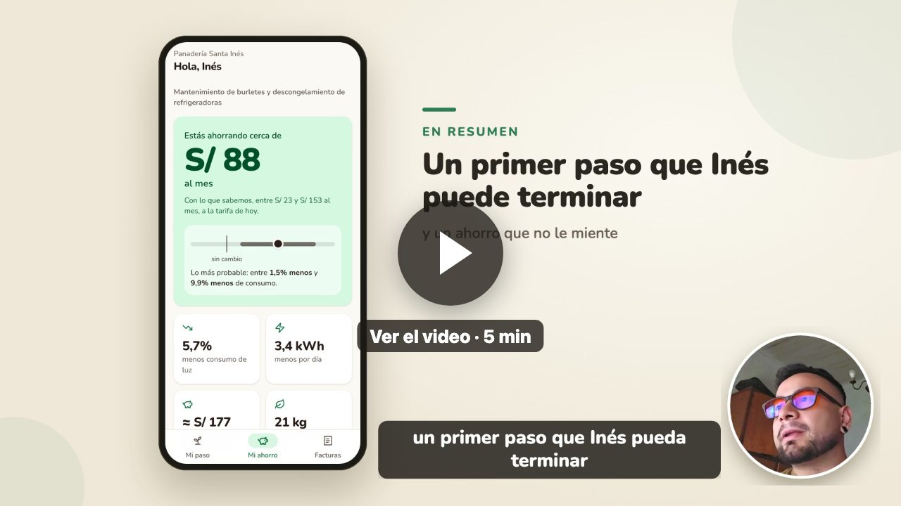

# Kamai: primer paso con ahorro medido

Mi solución para la prueba técnica full stack de Kamai. La idea es que la plataforma le recomiende a cada negocio una primera ecoinnovación que realmente pueda terminar, le explique por qué, y después le muestre cuánto ahorró sin inflar el número.

Si tienen poco tiempo, el [resumen](RESUMEN.md) entra en una página.

## Video

En 5 minutos cuento las decisiones y muestro la app funcionando.

[](https://drive.google.com/file/d/1f7aKyEfKCu9Hhjzn0oXxV6MASz877dbm/view?usp=sharing)

[Ver el video en Google Drive](https://drive.google.com/file/d/1f7aKyEfKCu9Hhjzn0oXxV6MASz877dbm/view?usp=sharing)

Todos los datos son los del enunciado (ficticios). Las facturas de julio a septiembre de Inés y las otras 6 panaderías las inventé yo para poder mostrar la medición funcionando.

## Qué hay en el repo

- `openspec/changes/add-primer-paso-ahorro-medido/`: la especificación, que es el entregable principal. Propuesta, diseño con las decisiones y lo que descarté, tareas y specs con escenarios. Pasa `openspec validate --strict`.
- `api/`: la pieza que elegí construir. Backend en Node con MongoDB: recomendación, medición del ahorro, manejo de fallas y el reporte para aliados, con sus pruebas.
- `web/`: esto no lo pedían. Lo hice para ver si las decisiones funcionaban del lado de Inés: una app para celular en React, la vista para aliados y unos recorridos automáticos que prueban los casos en pantalla.
- `evidence/`: pruebas, capturas y una tabla que cruza cada punto del PDF con lo que hice.

## Cómo correrlo

Necesita Node 20 o más nuevo.

```bash
cd web && npm install && npm run build
cd ../api && npm install
npm start
```

Queda en http://localhost:3000. Conviene abrirlo con el ancho de un celular.

Otros comandos, dentro de `api/`:

```bash
npm test                 # pruebas (lógica + API contra memoria y contra MongoDB en memoria)
npm run e2e              # recorre el caso completo por HTTP y deja el resultado en evidence/e2e.md
npm run start:mongo      # igual que npm start pero con MongoDB en memoria
npm run start:recorridos # habilita los recorridos: abrir http://localhost:3000/?recorridos
```

La vista para aliados está en http://localhost:3000/?aliados.

## Las decisiones, cortas

1. **Recomendación:** un solo motor que usan los cuatro lugares que hoy recomiendan. Para Inés sale mantenimiento de burletes y descongelamiento: entra en su presupuesto, ataca las refrigeradoras y la mayoría de las panaderías que la eligieron la terminó. Hornear por tandas queda como segundo paso.
2. **IA:** casi nada. Con tan pocos casos no tiene sentido entrenar un modelo, y un LLM decidiendo no se puede auditar. Uso reglas y un ajuste estadístico simple. El LLM queda para las subtareas, que ya existían.
3. **Ahorro:** lo comparo contra el propio consumo del negocio, en kWh por día, y lo paso a soles con la tarifa actual. Si el cambio no supera la variación normal de sus facturas, le digo que todavía no se puede saber.
4. **Fallas:** si la IA no responde, la persona ve los pasos de la guía. Los correos se reintentan sin repetirse. Una factura sin foto legible cuenta igual. Si edita o borra una factura, se recalcula todo y se le avisa qué cambió.
5. **Datos de otros negocios:** no muestro cifras de pares con menos de 5 negocios detrás.

El detalle está en el [diseño](openspec/changes/add-primer-paso-ahorro-medido/design.md).

## API

| Método | Ruta | Para qué |
|---|---|---|
| GET | `/businesses/:id/recommendations/first-step?surface=` | recomendación (la misma para home, catalog, diagnosis y email) |
| GET | `/businesses/:id` | datos básicos del negocio |
| POST | `/businesses/:id/plans` | aceptar el primer paso |
| PATCH | `/plans/:id/steps/:index` | marcar un paso como hecho |
| POST | `/plans/:id/complete` | terminarlo (fecha e impacto percibido) |
| POST | `/plans/:id/sub-tasks` | subtareas con IA, con respaldo |
| GET/POST | `/businesses/:id/bills` | facturas |
| PUT/DELETE | `/bills/:id` | editar o borrar una factura |
| GET | `/plans/:id/savings` | ahorro medido |
| POST | `/plans/:id/savings/seen` | la pantalla avisa que Inés ya vio el resultado |
| GET | `/allies/report` | reporte agregado para aliados |

## Lo que dejé afuera

Agua (sería el mismo método con otra unidad), lectura automática de fotos, corrección por temporada (hace falta un año de facturas), autenticación de los endpoints internos y las integraciones reales. Contra la IA, el correo y el almacenamiento uso clientes falsos con el mismo contrato.
